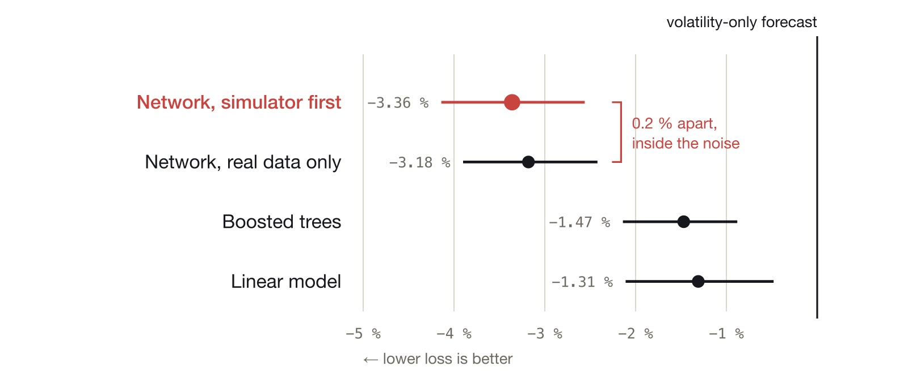

# sec-filing-forecasts

Built and tested on a real dataset of 11,569 company filings. For every filing, it forecasts how
much the company's stock can move.

A small Transformer (5.1 million parameters) looks at a company's reported numbers and the last 96
trading days, and forecasts a range for the stock's return against the industrial sector fund over
the next 5 and 20 trading days. It learns on simulated companies first, then on real 10-Q and 10-K
filings of 305 US industrial companies. I wrote the rules of the final test down and hashed them
before any outcome existed.

Findings: [`findings/findings.pdf`](findings/findings.pdf) (4 pages). One forecast, animated:
[herrei.github.io/sec-filing-forecasts](https://herrei.github.io/sec-filing-forecasts/). The story behind it:
[hermesreisner.com/work/finance-forecasting](https://hermesreisner.com/work/finance-forecasting/)

## What came out

On the last 3,329 filings (2023 to 2026), lower loss is better:

| network against | change in loss | |
|---|---|---|
| a forecast that only knows recent volatility | -3.4 % | better |
| linear quantile regression | -2.1 % | better |
| boosted trees | -1.9 % | better |
| the same network without the simulator | -0.2 % | no real difference |



- It is better at how wide the range should be, not at which way the stock goes. The network, the trees and the
  linear model each get the direction right about half the time.
- The simulator is not why it works. Trained on real filings only, the same network is as good.
- It did not hold every year. In 2020 it was worse than the volatility forecast.
- The SEC's bulk download has the wrong acceptance time for about two thirds of the filings I
  needed, so all times come from the SEC's XBRL archive and filing pages instead.

## Run it

Python 3.11 to 3.13.

```sh
python -m venv .venv && . .venv/bin/activate
pip install -e '.[dev]'
pytest
```

Simulation:

```sh
disclosure-research build-eval data/synthetic/stage-s-v2
python -m disclosure_forecasting.pipeline configs/stage-s/plan.json    # trains on cuda:0, then scores
python -m disclosure_forecasting.pipeline configs/stage-s2/plan.json
```

Real data, all on a CPU. The SEC wants a contact in the User-Agent:

```sh
export SEC_USER_AGENT="Your Name you@example.com" PYTHONPATH=src
scripts/fetch_sec_bulk.sh
python -m disclosure_forecasting.real.sec build
python -m disclosure_forecasting.real.prices fetch && python -m disclosure_forecasting.real.prices panel
python -m disclosure_forecasting.real.timestamps fetch-rss && python -m disclosure_forecasting.real.timestamps build
python -m disclosure_forecasting.real.records build && python -m disclosure_forecasting.real.records validate
python -m disclosure_forecasting.real.alfred fetch && python -m disclosure_forecasting.real.alfred build
python -m disclosure_forecasting.real.dataset build
mkdir -p data/processed/g4 && cp docs/PREREGISTRATION_G4.sha256 data/processed/g4/prereg.sha256
python -m disclosure_forecasting.real.g4 labels         # refuses if the plan was changed
python -m disclosure_forecasting.real.alfred features
python scripts/run_g4.py --workers 2 --threads 2        # all baselines and the 45 network runs
python -m disclosure_forecasting.real.report_g4 && python -m disclosure_forecasting.real.posthoc_g4
```

## What is where

```
src/disclosure_forecasting/        simulator, model, training, evaluation
src/disclosure_forecasting/real/   SEC data, prices, timestamps, audit, the final test
configs/                           the simulation runs
scripts/                           config writers, downloads, the final-test runner
docs/                              the test plans as written, with the final one's hash
findings/                          the findings as LaTeX and PDF
demo/                              the one-page demo (Astro)
data/audit/                        the 120 records I checked against the original filings
tests/
```

## Data

No data is included. The filings come from SEC EDGAR and are public. Prices come from Yahoo's chart
endpoint, which is unofficial, only has companies that are still listed, and can't be shared here.
The SEC's bulk files change over time; I used the ones from 2026-10-26.

The plans in `docs/` are kept exactly as written so the hash still matches. They mention a few
things that aren't in this repo, like the machine it ran on (ddp).

## License

MIT, see [LICENSE](LICENSE).
